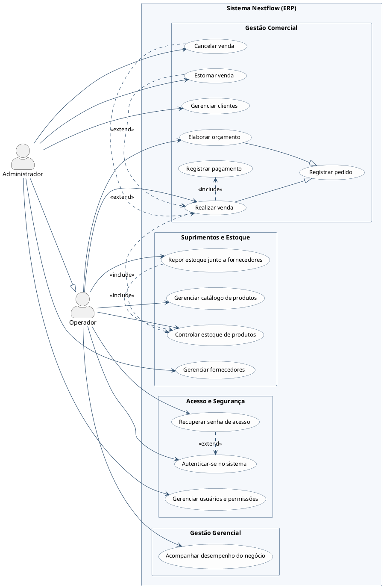

# Diagramas Nextflow — TCC

> **Objetivo:** documentação de diagramas do sistema ERP Nextflow (frontend + backend) para uso no TCC.
> **Formato:** PlantUML / Mermaid, prontos para exportação (ex.: importação no draw.io).

---

## 1. Diagrama de Caso de Uso

> **v2 — revisado com foco em Engenharia de Software / Análise de Requisitos**, após avaliação crítica indicando que a v1 estava modelando endpoints de API (CRUD explícito, pacotes por módulo de código, `include`/`extend` como chamada de função) em vez de objetivos de negócio dos atores. Ver [histórico da revisão](#histórico-da-revisão-v1--v2) no fim desta seção.

**Diretrizes aplicadas nesta versão:**
1. **Zero CRUD explícito** — "Cadastrar/Editar/Consultar/Inativar X" viraram um único caso de uso de alto nível: *"Gerenciar X"*.
2. **Sem tecnicalidades de infraestrutura** — removidos casos de uso que não entregam valor de negócio direto (verificação de sessão, logout, upload de imagem, CRUD de países/estados/cidades, integração com ViaCEP). Essas são preocupações de implementação, não objetivos do ator.
3. **Pacotes por domínio de negócio**, não por camada/módulo de código: *Acesso e Segurança*, *Gestão Comercial*, *Suprimentos e Estoque*, *Gestão Gerencial*.
4. **`<<include>>` reservado para comportamento obrigatório e reutilizado** entre casos de uso distintos (ex.: registrar pagamento é obrigatório e reaproveitado ao realizar uma venda; controlar estoque é obrigatório tanto ao vender quanto ao repor mercadoria). **`<<extend>>`** reservado para fluxos alternativos/excepcionais reais (recuperar senha quando o login falha; cancelar ou estornar uma venda já registrada).
5. **Generalização de casos de uso** para modelar variação de comportamento sem duplicar bolhas: *Elaborar Orçamento* e *Realizar Venda* são especializações de *Registrar Pedido* (mesmo processo de negócio, dois desfechos possíveis — reflete o campo `OrderType` do domínio sem expor o nome do enum).

**Atores:**
- **Operador** — vendedor/estoquista, executa a operação diária do ERP (vendas, orçamentos, estoque, compras).
- **Administrador** — herda tudo do Operador; responsável por dados mestres sensíveis (clientes, fornecedores, usuários/acessos) e por exceções que exigem governança (cancelamento e estorno de venda).

### Racional de negócio por caso de uso

| Caso de uso | O que significa para o ator | Por que não é CRUD |
|---|---|---|
| Gerenciar clientes / fornecedores | Manter o cadastro de quem a empresa vende/compra atualizado | Cadastrar, editar e inativar são passos técnicos do *mesmo* objetivo: manter o cadastro confiável |
| Registrar pedido (⊃ Elaborar orçamento / Realizar venda) | Formalizar uma intenção comercial com um cliente | O "tipo" (orçamento vs. venda) é uma variação do mesmo processo de negócio, modelada por generalização, não por dois CRUDs distintos |
| Registrar pagamento | Quitar financeiramente uma venda | Sub-comportamento obrigatório, sempre reexecutado ao concluir uma venda — por isso é `<<include>>`, não um caso de uso independente |
| Cancelar / Estornar venda | Reverter uma venda já concretizada, por desistência ou problema pós-venda | Fluxo excepcional e independente (nem toda venda é cancelada/estornada) — por isso `<<extend>>` |
| Gerenciar catálogo de produtos | Manter o portfólio vendável/comprável da empresa | Agrupa cadastro, categorização e imagem — detalhes de tela, não objetivos distintos do ator |
| Repor estoque junto a fornecedores | Garantir que não falte mercadoria | O pedido de compra em si é o objetivo; recebimento aciona controle de estoque (`<<include>>`) |
| Controlar estoque de produtos | Manter a quantidade em estoque confiável | Reutilizado tanto por vendas (saída) quanto por reposição (entrada) — comportamento compartilhado, não uma tela isolada |
| Acompanhar desempenho do negócio | Tomar decisões com base em indicadores | Dashboard é consumido como uma visão, não uma operação de dados |

### O que foi deliberadamente removido do nível de negócio

- **Verificar autenticação / logout** — mecânica de sessão, não uma meta do ator.
- **CRUD de países/estados/cidades** — dado de apoio/referência, sem processo de negócio associado; usado internamente por endereços de clientes/fornecedores.
- **Endereços/contatos e busca de CEP** — detalhe de preenchimento do cadastro de cliente/fornecedor, absorvido em "Gerenciar clientes/fornecedores".
- **Upload/remoção de imagem do produto** — detalhe de UI do catálogo, absorvido em "Gerenciar catálogo de produtos".

Esses itens continuam existindo como funcionalidades reais do sistema (e aparecem no ER e nos diagramas de sequência já existentes) — apenas não competem por espaço num diagrama de caso de uso, cujo público é "o que o sistema faz pelo negócio", não "quais telas/endpoints existem".

### Fonte dos dados

- **Controllers e autorização** (`nextflow/Controllers/*.cs`, `[RoleAuthorize(RoleEnum.Admin)]`): base para a divisão Operador/Administrador (clientes, fornecedores e usuários são dados mestres restritos a Admin; cancelamento/estorno de venda também).
- **Regras de negócio** (`nextflow.Application/UseCases/Orders`, `Sales`, `StockMovements`, `PurchaseOrders`): fluxo orçamento→venda→pagamento, geração automática de movimentação de estoque na venda, regras de cancelamento/estorno (estorno só até 7 dias após a última atualização).
- **`OrderType` (Domain/Enums)**: base conceitual da generalização Elaborar Orçamento / Realizar Venda.

---

#### Histórico da revisão (v1 → v2)

A v1 deste diagrama modelava 50 casos de uso praticamente 1:1 com os endpoints REST do backend, com pacotes por módulo de código (ex.: "Autenticação e Sessão", "Localização Geográfica") e relações `<<include>>`/`<<extend>>` usadas como se fossem chamadas de função. Isso é um erro comum de geração automática de UML: confundir *estrutura de código* com *modelo de análise de requisitos*. A v2 acima corrige isso elevando o nível de abstração para o que o ator efetivamente busca alcançar no negócio.

---

## 2. Diagrama de Classes (Domínio)

> **Escopo:** modelo de domínio completo — as 18 entidades de `nextflow.Domain/Models/`, seus relacionamentos e os enums que parametrizam seu comportamento. Documenta o **modelo conceitual do negócio**, não a implementação C#: construtores, DTOs, atributos de validação (`[Required]`, `[StringLength]` etc.) e propriedades de infraestrutura (`Preposition`/`Singular`/`Plural`, usadas só para mensagens de erro em português) foram omitidos por não agregarem à compreensão do domínio.

**Simplificações aplicadas nesta versão:**
1. **Boilerplate de exclusão lógica unificado** — `IsActive`, `Delete()` e `Reactivate()` aparecem uma única vez na interface `IDeletable`, em vez de repetidos nas 12 classes que a implementam.
2. **Somente métodos com regra de negócio explícita** — `Update(dto)` genérico foi omitido; ficaram só os métodos que expressam uma decisão do domínio (ex.: `Order.UpdateStatus()` valida a máquina de estados do pedido; `Product.SetMovementStock()` valida saldo de estoque).
3. **Enums como `<<enumeration>>`**, ligados por dependência (`..>`) às classes que os usam como tipo de atributo.
4. **Cores por pacote de negócio**, no mesmo espírito do diagrama de caso de uso (seção 1).

```mermaid
classDiagram
    direction TB

    %% ===================== Base / Contratos =====================
    class BaseModel {
        <<abstract>>
        +id: UUID
        +createAt: DateTime
    }

    class IDeletable {
        <<interface>>
        +isActive: bool
        +Delete()
        +Reactivate()
    }

    class Person {
        <<abstract>>
        +name: string
        +lastName: string
        +cpf: string
        +birthDate: Date
        +updateAt: DateTime
    }

    BaseModel <|-- Person
    IDeletable <|.. Person

    %% ===================== Acesso e Segurança =====================
    class User {
        +email: string
        -password: string
        +role: RoleEnum
        -refreshToken: string
        +UpdatePassword(dto)
        +SetRefreshToken(token)
        +RevokeRefreshToken()
    }

    class Client

    Person <|-- User
    Person <|-- Client

    %% ===================== Gestão Comercial =====================
    class Order {
        +status: OrderStatus
        +type: OrderType
        +lossReason: string
        +totalAmount: decimal
        +totalDiscount: decimal
        +updateAt: DateTime
        +UpdateStatus(newStatus, reason)
        +SetTotals(totalAmount, totalDiscount)
    }

    class OrderItem {
        +quantity: decimal
        +discount: decimal
        +unitPrice: decimal
        +UpdateDetails(quantity, discount)
        +SetPricing(unitPrice)
    }

    class Sale {
        +isActive: bool
    }

    class Payment {
        +amount: double
        +paymentMethod: PaymentMethod
        +isActive: bool
    }

    BaseModel <|-- Order
    BaseModel <|-- OrderItem
    BaseModel <|-- Sale
    BaseModel <|-- Payment
    IDeletable <|.. Sale
    IDeletable <|.. Payment

    %% ===================== Suprimentos e Estoque =====================
    class Supplier {
        +name: string
        +cnpj: string
        +isActive: bool
        +updateAt: DateTime
    }

    class Category {
        +description: string
        +isActive: bool
    }

    class CategoryProduct {
        +isActive: bool
    }

    class Product {
        +productCode: string
        +name: string
        +description: string
        +image: string
        +quantity: decimal
        +unitType: UnitType
        +price: decimal
        +validity: Date
        +isActive: bool
        +SetMovementStock(dto)
        +RevertMovementStock(movement)
        +UpdateImage(path)
        +RemoveImage()
    }

    class StockMovement {
        +quantity: double
        +movementType: MovementType
        +description: string
        +quote: decimal
        +SetQuote(quote)
    }

    BaseModel <|-- Supplier
    BaseModel <|-- Category
    BaseModel <|-- CategoryProduct
    BaseModel <|-- Product
    BaseModel <|-- StockMovement
    IDeletable <|.. Supplier
    IDeletable <|.. Category
    IDeletable <|.. CategoryProduct
    IDeletable <|.. Product

    %% ===================== Compras =====================
    class PurchaseOrder {
        +purchaseStatus: PurchaseStatus
        +totalAmount: decimal
        +note: string
        +updateAt: DateTime
        +SetTotalAmount(amount)
    }

    class PurchaseItem {
        +quantity: double
        +discount: decimal
        +costPrice: decimal
    }

    BaseModel <|-- PurchaseOrder
    BaseModel <|-- PurchaseItem
    IDeletable <|.. PurchaseOrder

    %% ===================== Localização e Cadastro =====================
    class Address {
        +description: string
        +street: string
        +number: string
        +district: string
        +complement: string
        +zipCode: string
        +isActive: bool
    }

    class Contact {
        +description: string
        +fone: string
        +email: string
    }

    class Country {
        +name: string
        +acronymIso: string
        +bacenCode: string
        +isActive: bool
    }

    class State {
        +name: string
        +acronym: string
        +ibgeCode: string
        +isActive: bool
    }

    class City {
        +name: string
        +ibgeCode: string
        +isActive: bool
    }

    BaseModel <|-- Address
    BaseModel <|-- Contact
    BaseModel <|-- Country
    BaseModel <|-- State
    BaseModel <|-- City
    IDeletable <|.. Address
    IDeletable <|.. Country
    IDeletable <|.. State
    IDeletable <|.. City

    %% ===================== Enumerações =====================
    class RoleEnum {
        <<enumeration>>
        User
        Admin
    }
    class OrderType {
        <<enumeration>>
        Budget
        Sale
    }
    class OrderStatus {
        <<enumeration>>
        Budget
        PendingPayment
        PaymentConfirmed
        Canceled
        Refunded
    }
    class PaymentMethod {
        <<enumeration>>
        Cash
        CreditCard
        DebitCard
        BankTransfer
        Pix
        Ticket
    }
    class MovementType {
        <<enumeration>>
        Entry
        Exit
        Adjustment
        Sales
        Return
    }
    class PurchaseStatus {
        <<enumeration>>
        Budget
        Pending
        Received
        Canceled
    }
    class UnitType {
        <<enumeration>>
        Unit
        Kilogram
        Liter
        Meter
    }

    User ..> RoleEnum
    Order ..> OrderType
    Order ..> OrderStatus
    Payment ..> PaymentMethod
    StockMovement ..> MovementType
    PurchaseOrder ..> PurchaseStatus
    Product ..> UnitType

    %% ===================== Relacionamentos de negócio =====================
    Client "1" --> "0..*" Order : realiza
    User "1" --> "0..*" Order : atende
    Order "1" *-- "0..*" OrderItem : contém
    Product "1" --> "0..*" OrderItem : referenciado em
    Order "1" --> "0..*" Sale : gera
    User "1" --> "0..*" Sale : registra
    Sale "1" *-- "0..*" Payment : recebe

    Supplier "1" --> "0..*" Product : fornece
    Category "1" o-- "0..*" CategoryProduct : classifica
    Product "1" o-- "0..*" CategoryProduct : é classificado em
    Product "1" --> "0..*" StockMovement : movimenta
    User "1" --> "0..*" StockMovement : registra

    Supplier "1" --> "0..*" PurchaseOrder : recebe
    PurchaseOrder "1" *-- "0..*" PurchaseItem : contém
    Product "1" --> "0..*" PurchaseItem : comprado em

    Client "1" --> "0..*" Address : possui
    Supplier "1" --> "0..*" Address : possui
    Client "1" --> "0..*" Contact : possui
    Supplier "1" --> "0..*" Contact : possui

    Country "1" --> "0..*" State : contém
    State "1" --> "0..*" City : contém
    City "1" --> "0..*" Address : localiza
    State "1" --> "0..*" Address : localiza

    %% ===================== Camada de Aplicação (Casos de Uso) =====================
    %% Uma classe por Controller/rota, agrupando as *UseCase reais do código (1 arquivo por operação).
    %% Ligação com o Domínio é dependência (..>), não herança: a Model não conhece o caso de uso.

    class UserUseCases {
        <<application>>
        +Create()
        +GetAll()
        +GetById()
        +Update()
        +UpdatePassword()
        +Delete()
        +Reactivate()
        +Login()
        +CheckAuth()
        +CreateToken()
        +RevokeToken()
    }
    class ClientUseCases {
        <<application>>
        +Create()
        +GetAll()
        +GetById()
        +Update()
        +Delete()
        +Reactivate()
    }
    class SupplierUseCases {
        <<application>>
        +Create()
        +GetAll()
        +GetById()
        +Update()
        +Delete()
        +Reactivate()
    }
    class CategoryUseCases {
        <<application>>
        +Create()
        +GetAll()
        +GetById()
        +Update()
        +Delete()
        +CreateCategoryProduct()
        +GetAllCategoryProducts()
    }
    class ProductUseCases {
        <<application>>
        +Create()
        +GetAll()
        +GetById()
        +Update()
        +Delete()
        +UpdateImage()
        +RemoveImage()
    }
    class StockMovementUseCases {
        <<application>>
        +Create()
        +GetAll()
        +GetById()
        +Delete()
    }
    class OrderUseCases {
        <<application>>
        +Create()
        +GetAll()
        +GetById()
        +Update()
        +UpdateStatus()
    }
    class SaleUseCases {
        <<application>>
        +Create()
        +GetAll()
        +GetById()
        +Delete()
    }
    class PurchaseOrderUseCases {
        <<application>>
        +Create()
        +GetAll()
        +GetById()
        +Update()
        +Delete()
    }
    class AddressUseCases {
        <<application>>
        +Create()
        +GetAll()
        +GetById()
        +Update()
        +Delete()
        +ResolveFromCep()
    }
    class ContactUseCases {
        <<application>>
        +Create()
        +GetAll()
        +GetById()
        +Update()
        +Delete()
    }
    class CountryUseCases {
        <<application>>
        +Create()
        +GetAll()
        +GetById()
        +Update()
        +Delete()
    }
    class StateUseCases {
        <<application>>
        +Create()
        +GetAll()
        +GetById()
        +Update()
        +Delete()
    }
    class CityUseCases {
        <<application>>
        +Create()
        +GetAll()
        +GetById()
        +Update()
        +Delete()
    }

    UserUseCases ..> User : opera sobre
    ClientUseCases ..> Client : opera sobre
    SupplierUseCases ..> Supplier : opera sobre
    CategoryUseCases ..> Category : opera sobre
    CategoryUseCases ..> CategoryProduct : opera sobre
    ProductUseCases ..> Product : opera sobre
    StockMovementUseCases ..> StockMovement : opera sobre
    OrderUseCases ..> Order : opera sobre
    OrderUseCases ..> OrderItem : opera sobre
    SaleUseCases ..> Sale : opera sobre
    SaleUseCases ..> Payment : opera sobre
    PurchaseOrderUseCases ..> PurchaseOrder : opera sobre
    PurchaseOrderUseCases ..> PurchaseItem : opera sobre
    AddressUseCases ..> Address : opera sobre
    ContactUseCases ..> Contact : opera sobre
    CountryUseCases ..> Country : opera sobre
    StateUseCases ..> State : opera sobre
    CityUseCases ..> City : opera sobre

    %% ===================== Estilos por pacote de negócio =====================
    classDef base fill:#F5F8FC,stroke:#2F4F6F,color:#2F4F6F
    classDef acesso fill:#EAF2FB,stroke:#2F6F9A,color:#1B3B57
    classDef comercial fill:#FDF3E7,stroke:#B0793A,color:#5C3E1B
    classDef suprimentos fill:#EFF7EC,stroke:#4C8C5B,color:#264A2E
    classDef compras fill:#F7EDF5,stroke:#8C4C7F,color:#4A2740
    classDef localizacao fill:#F5F5F0,stroke:#8C8465,color:#4A4636
    classDef enumeracao fill:#FFFDF5,stroke:#B0A44A,color:#5C551F
    classDef usecase fill:#F1F2F4,stroke:#5B6472,color:#3A4048,stroke-dasharray: 3 2

    cssClass "BaseModel,Person,IDeletable" base
    cssClass "User,Client" acesso
    cssClass "Order,OrderItem,Sale,Payment" comercial
    cssClass "Supplier,Category,CategoryProduct,Product,StockMovement" suprimentos
    cssClass "PurchaseOrder,PurchaseItem" compras
    cssClass "Address,Contact,Country,State,City" localizacao
    cssClass "RoleEnum,OrderType,OrderStatus,PaymentMethod,MovementType,PurchaseStatus,UnitType" enumeracao
    cssClass "UserUseCases,ClientUseCases,SupplierUseCases,CategoryUseCases,ProductUseCases,StockMovementUseCases,OrderUseCases,SaleUseCases,PurchaseOrderUseCases,AddressUseCases,ContactUseCases,CountryUseCases,StateUseCases,CityUseCases" usecase
```

5. **Camada de Aplicação representada, mas não fundida ao Domínio** — cada Controller delega para uma classe de caso de uso por operação (`CreateProductUseCase`, `GetAllProductsUseCase`...); para não repetir ~90 classes no diagrama, elas foram agrupadas por entidade numa classe conceitual `<<application>>` (ex.: `ProductUseCases`), com um método por operação real. A ligação com o Domínio é uma **dependência** (`..>`), não herança — reforça que a regra de negócio pesada mora na Model (seção anterior) e a Model **não conhece** a camada de aplicação, só o contrário.

### Notas de modelagem

| Decisão | Justificativa |
|---|---|
| `Address`/`Contact` têm `ClientId` **e** `SupplierId` opcionais (não um polimorfismo genérico `OwnerId`/`OwnerType`) | Reflete literalmente o código: dois FKs nulláveis, não uma coluna de tipo de dono |
| `CategoryProduct` modelada como classe associativa (não uma linha N:N direta entre `Category` e `Product`) | No código é uma entidade própria, com `Id` e `IsActive` — carrega estado, não é só uma tabela de junção |
| `Order` não implementa `IDeletable` | O ciclo de vida do pedido é controlado por uma máquina de estados (`OrderStatus`: Orçamento → Pendente → Confirmado → Cancelado/Estornado), não por exclusão lógica simples |
| `StockMovement` e `PurchaseItem` não implementam `IDeletable` | São registros de histórico (movimentação de estoque, item de compra já processado); o domínio não permite "desativar" um lançamento retroativo |
| `Order "1" → "0..*" Sale` (não `1 → 1`) | Fiel ao schema (`Order.Sales: ICollection<Sale>`); hoje a regra de negócio gera no máximo uma venda por pedido, mas o modelo de dados permite mais |
| `Product` não tem `CostPrice` | O custo é registrado por compra, no atributo `costPrice` de `PurchaseItem` — não é um campo fixo do produto |
| `OrderItem`, `Payment`, `PurchaseItem` e `CategoryProduct` não têm caixa de UseCases própria | Não existe rota/Controller dedicado para eles — são geridos dentro do caso de uso do agregado raiz (`OrderUseCases`, `SaleUseCases`, `PurchaseOrderUseCases`, `CategoryUseCases`, respectivamente). O código não tem pasta `UseCases/Payments`, `OrderItems` etc. — reflete fronteira de agregado (DDD), não uma omissão do diagrama |
| `ContactUseCases.Delete()` | No código a classe se chama `DeleteClientUseCase` (dentro da pasta `Contacts/`), mas usa `IContactRepository` — nome herdado de copy-paste do módulo `Clients`, sem efeito funcional. Simplificado no diagrama para não propagar a inconsistência |

### Fonte dos dados

- **Modelos de domínio**: `nextflow.Domain/Models/*.cs` (18 entidades) e `Models/Base/{BaseModel,Person}.cs`
- **Enums**: `nextflow.Domain/Enums/*.cs` (7 enums)
- **Interface de exclusão lógica**: `nextflow.Domain/Interfaces/Models/IDeletable.cs`
- **Relacionamentos e constraints**: `nextflow.Infrastructure/Database/AppDbContext.cs` (índices únicos em `User.Email`, `User.CPF`, `Client.CPF`, `Supplier.CNPJ`)
- **Casos de uso**: `nextflow.Application/UseCases/{Addresses,Categories,Cities,Clients,Contacts,Countries,Orders,Products,PurchaseOrders,Sales,States,StockMovements,Suppliers,Users}/*.cs` (uma classe por operação no código; agrupadas por entidade no diagrama)

---

## Próximos diagramas (planejados)

- [x] Diagrama de Entidade-Relacionamento — já existente (fora deste arquivo)
- [x] Diagramas de sequência — já existentes (fora deste arquivo)
- [x] Diagrama de Classes — seção 2 deste arquivo
- [ ] Diagrama de arquitetura em camadas do backend (Clean Architecture)
